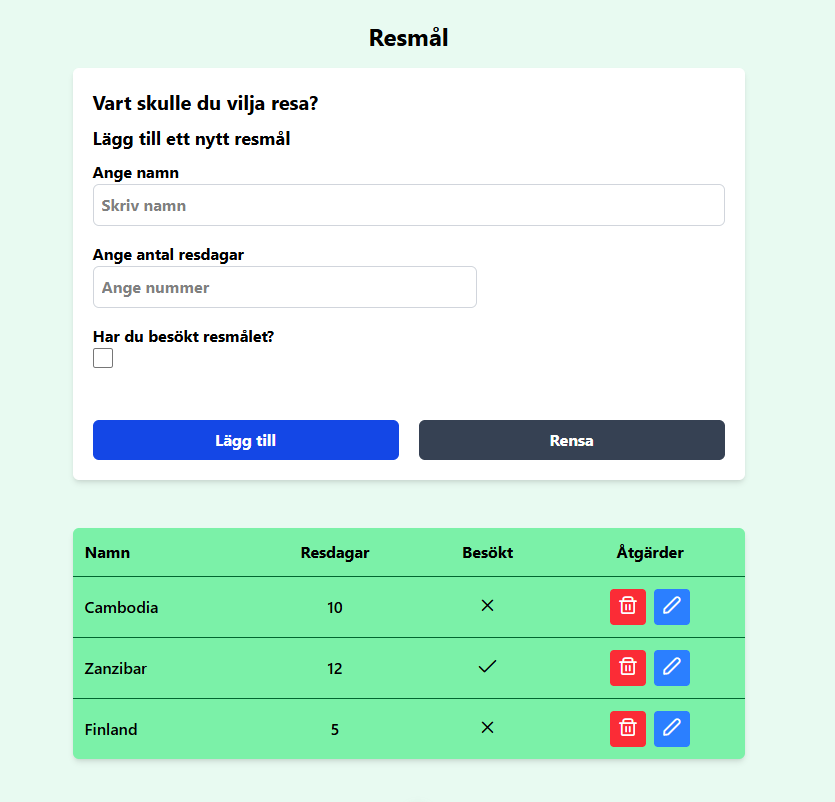

# Laboration 3 | Fullstack-utveckling med ramverk DT193G

## Webbplats för resmål

Webbplatsen är byggd med Vue, Tailwind CSS och Vite. Den konsumerar en REST-webbtjänst (laboration 2) som hanterar resmål. Full CRUD-funktionalitet är implementerad i användargränssnittet genom webbtjänsten. Validering av inputs görs i formuläret och felmeddelanden samt lyckade meddelanden visas i gränssnittet.



Webbplatsen har tre sidor:

- **Hem:** Reflektioner kring mitt resintresse.
- **Resmål:** Hämtar in resmål och visar dem i en tabell. Möjlighet att lägga till, redigera och radera resmål finns i gränssnittet.
- **Info:** Information och tankar kring mitt arbete med Vue.

**Komponenter** skapades för att hantera resmålen och webbplatsen, t.ex tabell och formulär samt mindre komponenter som footern och delar av sidor.

**Views** skapades för vardera sida i webbplatsen. Samt en 404-sida.

**Props** används för att skicka data till childkomponenter, som tabellen eller formuläret, från parentkomponenten vacationView.vue.

**Emits** används för att skicka händelser som när man raderar ett resmål från childkomponenten till vacationView.vue.

Laborationen använder en dotenv-fil för att lagra webbtjänstens URL.

## Publicerad länk

https://fbfullstack-lab3.vercel.app/

## Kör projektet lokalt

Klona ner projektet,

```
git clone https://github.com/filipbergander/fbfullstack-lab3.git
```

Installera beroenden:

```
npm install
```

Skapa en `.env`-fil i projektets root-mapp och lägg till din webbtjänst URL i filen.

Starta projektet:

```sh
npm run dev
```
